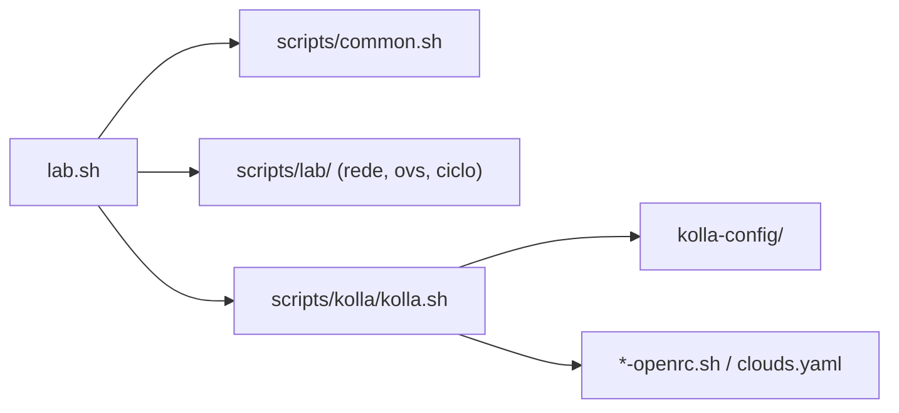

# Documentação dos scripts do lab

Referência dos scripts shell do lab OpenStack AIO. O guia operacional (como subir a nuvem) está em [`../README.md`](../README.md).

## Índice

| Script / ficheiro | Papel | Doc |
|-------------------|-------|-----|
| [`../lab.sh`](../lab.sh) | Entrypoint único: prep, deploy, fixes, status, stop, start | [`lab.sh.md`](lab.sh.md) |
| [`../scripts/`](../scripts/) | Módulos carregados pelo `lab.sh` (`common.sh`, `lab/`, `kolla/`) | [`lab.sh.md`](lab.sh.md) |
| [`../kolla-config/*-openrc*.sh`](../kolla-config/) | Credenciais CLI OpenStack (`source`) | [`kolla-config-scripts.md`](kolla-config-scripts.md) |
| [`../kolla-config/clouds.yaml`](../kolla-config/clouds.yaml) | Clouds para `OS_CLOUD=…` | [`kolla-config-scripts.md`](kolla-config-scripts.md) |
| Enunciado Trabalho 1 | REQ01–REQ24 + substitutivo REQ25 | [`enunciado-trabalho-1.md`](enunciado-trabalho-1.md) |
| Quickstart Kolla | Referência do Kolla-Ansible em containers | [`kolla-ansible-quickstart.md`](kolla-ansible-quickstart.md) |
| Portas | VIP, containers Kolla e app do trabalho | [`ports.md`](ports.md) |
| Tema Horizon Lux | Cores/layout custom (herda default) | [`horizon-theme-lux.md`](horizon-theme-lux.md) |

## Fluxo

1. O aluno usa **`lab.sh`** (prep, bootstrap, deploy, status, fixes).
2. Comandos Kolla (`bootstrap`, `prechecks`, `deploy`, `post-deploy`, `all`, `stop-kolla`) são executados por **`scripts/kolla/kolla.sh`**, sempre pelo `lab.sh`.
3. O Kolla lê **`kolla-config/`** (`globals.yml`, `passwords.yml`).
4. Após **`post-deploy`**, o Ansible gera `*-openrc.sh` e `clouds.yaml` para a CLI OpenStack.

**Sem senhas nestes docs.** Valores reais estão em `passwords.yml` / openrc / `clouds.yaml` — não partilhar.
