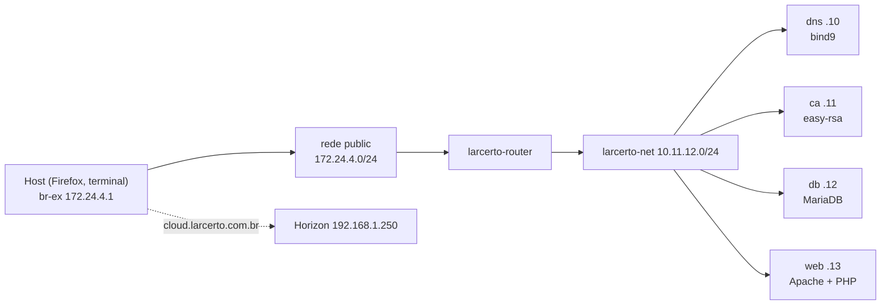

# Nuvem LarCerto — do lab ligado até `https://larcerto.com.br`

Passo a passo do Trabalho 1 sobre o Kolla AIO deste projeto. Requisitos:
[`enunciado-trabalho-1.md`](enunciado-trabalho-1.md); a app: [`../app/README.md`](../app/README.md).

## Topologia (REQ09, "completa")



Cada VM tem um floating IP da `public` (pool `.100–.199`). O `db` só aceita a 3306 vindo da
`larcerto-net`.

## Diferenças em relação às aulas

| Aula | Aqui | Por quê |
|------|------|---------|
| DevStack em Multipass (M06) | Kolla AIO no host | lab do repo |
| br-ex com IP e NAT refeitos à mão após reboot (M06/M07) | `./project/lab.sh ext-net` (chamado pelo `start`) | mesma ideia, automatizada e reversível (`--down`) |
| boot de volume (M07/M08) | boot da imagem, disco de 10 GB do flavor | Kolla deployado sem Cinder |
| DNS e CA em VMs Multipass (M05) | VMs `dns` e `ca` dentro do OpenStack | topologia "completa", sem mexer mais no host |
| senha no `providers.tf` (M09) | `clouds.yaml` do `devops1` fora do git | segredos fora do repo |
| CSR gerado na web e assinado na CA (M05) | `build-server-full` na VM `ca` | menos passos; a chave chega à web pelo Ansible |

## Pré-requisitos (uma vez, no host)

| O quê | Comando | Observação |
|-------|---------|------------|
| Cliente OpenStack no venv | `~/venvs/kolla/bin/pip install python-openstackclient` | só o venv, não o sistema |
| Terraform | binário em `~/.local/bin/terraform` (releases.hashicorp.com) | sem apt |
| Chave SSH | `ssh-keygen -t ed25519` (se não existir `~/.ssh/id_ed25519`) | |
| Senha do banco | `cp project/ansible/group_vars/all/secrets.yml.example project/ansible/group_vars/all/secrets.yml` e editar | fora do git; com a app local criada (`project/app/.env`), o `install-app` copia o `DB_PASSWORD` |
| `dig` | já vem no `bind9-dnsutils`/`dnsutils` | só para conferir |

## Subir tudo

```bash
./project/lab.sh install-app           # confere os pré-requisitos e roda as etapas abaixo; para na que falhar
```

Se a instalação já existe (depois de um reboot ou de `lab.sh stop`), `./project/lab.sh start-app`
religa as VMs e a app sem recriar nada.

Passos manuais (o que o `install-app` roda, na mesma ordem):

```bash
./project/lab.sh start                 # Kolla + ext-net (br-ex 172.24.4.1 + NAT) + fix-wired
./project/cloud/bootstrap.sh           # admin: public, ds1G, ubuntu-22.04, projeto larcerto, devops1
export OS_CLIENT_CONFIG_FILE=$PWD/project/cloud/secrets/clouds.yaml OS_CLOUD=larcerto-devops1
cd project/terraform && terraform init && terraform apply     # 4 VMs + inventory/hosts.ini
cd ../ansible && ~/venvs/kolla/bin/ansible-playbook site.yml  # dns, ca, db, web
cd ../.. && ./project/lab.sh dns-host  # host resolve *.larcerto.com.br pela VM dns
```

### Confiar na CA no navegador (sem abrir as configurações)

Enquanto a CA LarCerto não estiver no navegador, `https://larcerto.com.br` abre com "Not Secure",
mesmo com o certificado certo no `web` (`./project/lab.sh cert` mostra `servido: igual`).

```bash
sudo apt install libnss3-tools   # uma vez: traz o certutil (pacote do sistema, pede senha)
./project/lab.sh cert trust      # importa ca.crt em cada banco NSS do usuário, sem sudo
```

O `cert trust` imprime uma linha por banco (`importado`, `ja estava`, `substituido` ou `falhou`) e
procura em:

| Navegador | Banco |
| --------- | ----- |
| Brave / Chrome / Chromium nativos | `~/.pki/nssdb` |
| Brave / Chrome / Chromium em flatpak | `~/.var/app/<app>/data/pki/nssdb` |
| Firefox nativo, flatpak ou snap | `cert9.db` de cada perfil |

Depois **feche o navegador por completo** (todas as janelas, não só a aba) e abra de novo: ele só lê a
CA ao iniciar. A CA é reaproveitada a cada recriação das VMs, então isso é feito uma vez só.

Manual, se preferir: Configurações → Certificados → Autoridades → Importar
`project/ansible/files/pki/ca.crt` → "confiar para identificar sites".

Ver a validade e se o `web` serve o mesmo certificado: `./project/lab.sh cert` (exit 2 se expirou,
se a cadeia não confere ou se o `web` serve outro). Emitir de novo com a mesma CA:
`./project/lab.sh cert renew`. Trocar a CA (quebra a confiança no navegador até reimportar):
`./project/lab.sh cert renew --new-ca`, que copia `files/pki/` antes e pede a palavra `nova-ca`.

### Entrar no terminal das VMs

SSH com o usuário `ubuntu` e a chave do host, no floating IP de cada VM (está no inventário gerado
pelo Terraform):

```bash
grep ansible_host project/ansible/inventory/hosts.ini   # dns, ca, db, web e o IP de cada uma
ssh -i ~/.ssh/id_ed25519 ubuntu@<floating-ip>           # ex.: o da web
```

Depois de recriar as VMs os IPs e as chaves de host mudam: se o `ssh` reclamar da chave, rode
`ssh-keygen -R <floating-ip>` e entre de novo.

## Conferir

```bash
bash project/tests/cloud-checks.sh     # dns_www, dns_cloud, dns_db_from_web, http_redirect, https_ok
```

## Recriar (demonstração / REQ25)

```bash
cd project/terraform && terraform destroy && terraform apply
cd ../ansible && ~/venvs/kolla/bin/ansible-playbook site.yml
```

## Desfazer no host

```bash
./project/lab.sh dns-host --down       # resolvedor do host volta ao normal
./project/lab.sh ext-net --down        # tira o IP da br-ex e as regras de NAT/FORWARD
```

## App

O CRUD de imóveis fica em [`../app/README.md`](../app/README.md) e pode
ser testado antes, sem a nuvem, pelo Docker Compose local (`http://127.0.0.1:8088`). O `site.yml` instala
na VM `web` o PHP 8.4 com GD (`php8.4-gd`) e na VM `db` o MariaDB 12.3. Na VM `db`, ele cria a tabela
`imoveis` (10 campos, com `capa`) com os 22 anúncios-semente, só se estiver vazia. Na VM `web`, publica
`project/app/public/`, `backend/` e `frontend/views/`, instala `apache/larcerto.conf` e
`99-larcerto.ini` e cria `/var/www/larcerto/storage/uploads` para as fotos. Recriar a VM `web` apaga as
fotos. Copia também o `run.sh` e o `sql/` para `/var/www/larcerto/` e instala o `mariadb-client` e o `php8.4-cli`: na VM
`web`, `sudo /var/www/larcerto/run.sh setup` (ou `ps`, `logs`, `db:populate`, `db:reset`, `db:console`)
faz o mesmo que no local, contra a VM `db`. `https://larcerto.com.br` passa a mostrar o CRUD. Sem
`public/index.php`, a VM serve a página provisória que só testa o banco.
