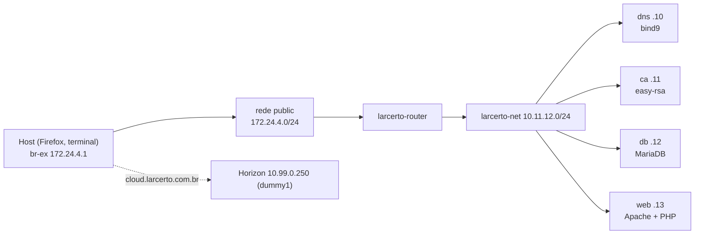

# Nuvem LarCerto — do lab ligado até `https://larcerto.com.br`

Passo a passo do Trabalho 1 sobre o Kolla AIO deste projeto. Requisitos:
[`enunciado-trabalho-1.md`](enunciado-trabalho-1.md); a app: [`../app/README.md`](../app/README.md).
Senhas, CLI, estado e SSH numa página só: [Comandos úteis](#comandos-úteis).

## Topologia (REQ09, "completa")



Cada VM tem um floating IP da `public` (pool `.100–.199`). O `db` só aceita a 3306 vindo da
`larcerto-net`.

## Diferenças em relação às aulas

| Aula | Aqui | Por quê |
|------|------|---------|
| DevStack em Multipass (M06) | Kolla AIO no host | lab do repo |
| br-ex com IP e NAT refeitos à mão após reboot (M06/M07) | `./larcerto.sh ext-net` (chamado pelo `start`) | mesma ideia, automatizada e reversível (`--down`) |
| boot de volume (M07/M08) | boot da imagem, disco de 10 GB do flavor | Kolla deployado sem Cinder |
| DNS e CA em VMs Multipass (M05) | VMs `dns` e `ca` dentro do OpenStack | topologia "completa", sem mexer mais no host |
| senha no `providers.tf` (M09) | `clouds.yaml` do `devops1` fora do git | segredos fora do repo |
| CSR gerado na web e assinado na CA (M05) | `build-server-full` na VM `ca` | menos passos; a chave chega à web pelo Ansible |

## Pré-requisitos (uma vez, no host)

| O quê | Comando | Observação |
|-------|---------|------------|
| Cliente OpenStack no venv | `./larcerto.sh venv` (ou `~/venvs/kolla/bin/pip install python-openstackclient`) | só o venv, não o sistema |
| Terraform | binário em `~/.local/bin/terraform` (releases.hashicorp.com) | sem apt |
| Chave SSH | `ssh-keygen -t ed25519` (se não existir `~/.ssh/id_ed25519`) | |
| Senha do banco | `cp ansible/group_vars/all/secrets.yml.example ansible/group_vars/all/secrets.yml` e editar | fora do git; com a app local criada (`app/.env`), o `install-app` copia o `DB_PASSWORD` |
| `dig` | já vem no `bind9-dnsutils`/`dnsutils` | só para conferir |

## Subir tudo

```bash
./larcerto.sh install-app           # confere os pré-requisitos e roda as etapas abaixo; para na que falhar
```

Se a instalação já existe (depois de um reboot ou de `larcerto.sh stop`), `./larcerto.sh start-app`
religa as VMs e a app sem recriar nada.

Passos manuais (o que o `install-app` roda, na mesma ordem):

```bash
./larcerto.sh start                 # Kolla + ext-net (br-ex 172.24.4.1 + NAT) + fix-wired
./cloud/bootstrap.sh           # admin: public, ds1G, ubuntu-22.04, projeto larcerto, devops1
export OS_CLIENT_CONFIG_FILE=$PWD/cloud/secrets/clouds.yaml OS_CLOUD=larcerto-devops1
cd terraform && terraform init && terraform apply     # 4 VMs + inventory/hosts.ini
cd ../ansible && ~/venvs/kolla/bin/ansible-playbook site.yml  # dns, ca, db, web
cd .. && ./larcerto.sh dns-host  # host resolve *.larcerto.com.br pela VM dns
```

### Confiar na CA no navegador (sem abrir as configurações)

Enquanto a CA LarCerto não estiver no navegador, `https://larcerto.com.br` abre com "Not Secure",
mesmo com o certificado certo no `web` (`./larcerto.sh cert` mostra `servido: igual`).

```bash
sudo apt install libnss3-tools   # uma vez: traz o certutil (pacote do sistema, pede senha)
./larcerto.sh cert trust      # importa ca.crt em cada banco NSS do usuário, sem sudo
```

O `cert trust` imprime uma linha por banco (`importado`, `ja estava`, `substituido` ou `falhou`) e
procura em:

| Navegador | Banco |
| --------- | ----- |
| Brave / Chrome / Chromium nativos | `~/.pki/nssdb` |
| Brave / Chrome / Chromium em flatpak | `~/.var/app/<app>/data/pki/nssdb` |
| Firefox nativo, flatpak ou snap | `cert9.db` de cada perfil |

Depois **feche o navegador por completo** (todas as janelas, não só a aba) e abra de novo: ele só lê a
CA ao iniciar. A CA é reaproveitada a cada recriação das VMs (`recreate-app`), então isso é feito
uma vez por CA: de novo só quando o projeto sobe do zero (`clear-all` + `all`), que cria uma CA nova.

Manual, se preferir: Configurações → Certificados → Autoridades → Importar
`ansible/files/pki/ca.crt` → "confiar para identificar sites".

Ver a validade e se o `web` serve o mesmo certificado: `./larcerto.sh cert` (exit 2 se expirou,
se a cadeia não confere ou se o `web` serve outro). Emitir de novo com a mesma CA:
`./larcerto.sh cert renew`. Trocar a CA (quebra a confiança no navegador até reimportar):
`./larcerto.sh cert renew --new-ca`, que copia `files/pki/` antes e pede a palavra `nova-ca`.

### HTTPS do Horizon (`https://cloud.larcerto.com.br`)

Opcional (REQ12). A mesma CA LarCerto assina um certificado próprio do painel (`cloud` e o apelido
`horizon`), emitido na VM `ca`; nada é pago e nada sai do lab. O Kolla não liga o TLS só do painel com
um VIP único, então um frontend extra do HAProxy do Kolla
([`kolla-config/config/haproxy/services.d/horizon-https.cfg`](../kolla-config/config/haproxy/services.d/horizon-https.cfg))
serve o Horizon em `10.99.0.250:443`. As APIs, os openrc e o Terraform continuam em HTTP.

```bash
./larcerto.sh cert cloud   # emite na VM ca e grava /etc/kolla/haproxy/haproxy.pem (root)
./larcerto.sh deploy       # uma vez: cria o frontend 443 e o ajuste do Horizon; o Kolla reinicia o haproxy
./larcerto.sh cert         # bloco "Horizon (cloud)": validade e servido: igual
bash tests/cloud-checks.sh https_cloud
```

Como a CA é a mesma, o navegador que já passou pelo `cert trust` confia no painel sem outro passo
(o `cert trust` de novo diz `ja estava`). O `cert cloud` só emite de novo se `files/pki/cloud.crt`
faltar ou não conferir com a CA (por exemplo, depois de um `cert renew --new-ca`); com o frontend já
criado, ele mesmo reinicia o haproxy para servir o certificado novo.

Desfazer (o template fica no repo; sem o `.pem` ele sai vazio):

```bash
sudo rm /etc/kolla/haproxy/haproxy.pem /etc/kolla/haproxy/services.d/horizon-https.cfg
docker exec haproxy rm -f /etc/haproxy/certificates/haproxy.pem   # cópia no volume letsencrypt_certificates
./larcerto.sh deploy
```

Não apague só o template do repo: o Kolla não remove o `.cfg` já gerado em `/etc/kolla`, e a cópia do
`.pem` fica no volume do container, então a 443 continuaria no ar com o certificado antigo.

### Ver as VMs

```bash
./larcerto.sh vms
```

Mostra as VMs do projeto `larcerto` como o `devops1` (nome, status, IP privado e floating IP) e a
linha de `ssh` de cada uma que está `ACTIVE`. Lê da API, então vale mesmo depois de um novo
`terraform apply` trocar os floating IPs. No Horizon, como `admin`, elas ficam em Admin → Computação
→ Instâncias (em Projeto → Instâncias não aparecem: o `admin` não é membro do `larcerto`).

### Entrar no terminal das VMs

SSH com o usuário `ubuntu` e a chave do host, no floating IP de cada VM (está no inventário gerado
pelo Terraform):

```bash
grep ansible_host ansible/inventory/hosts.ini   # dns, ca, db, web e o IP de cada uma
ssh -i ~/.ssh/id_ed25519 ubuntu@<floating-ip>           # ex.: o da web
```

Depois de recriar as VMs os IPs e as chaves de host mudam: se o `ssh` reclamar da chave, rode
`ssh-keygen -R <floating-ip>` e entre de novo.

## Conferir

```bash
bash tests/cloud-checks.sh     # dns_www, dns_cloud, dns_coringa, dns_horizon, dns_db_from_web, http_redirect, https_ok
bash tests/cloud-checks.sh https_cloud   # opcional: Horizon por HTTPS (depois do cert cloud)
```

Nomes da zona `larcerto.com.br` (VM `dns`): `larcerto.com.br`, `www` e `web` vão para a web, `dns` e
`ca` para as VMs delas, `db` para o IP privado do banco e `cloud` para o Horizon (`10.99.0.250`).
`horizon.larcerto.com.br` é um apelido (`CNAME`) de `cloud`, e o registro coringa `*` manda qualquer
outro nome (ex.: `qualquer.larcerto.com.br`) para a web, como o certificado wildcard `*.larcerto.com.br`.

```bash
resolvectl query qualquer.larcerto.com.br   # floating IP da web (coringa)
resolvectl query horizon.larcerto.com.br    # cloud.larcerto.com.br -> 10.99.0.250 (CNAME)
```

## Recriar (demonstração / REQ25)

```bash
./larcerto.sh recreate-app          # pede para digitar larcerto; --yes pula a pergunta
```

Apaga as VMs, a rede, o roteador e os floating IPs (`terraform destroy`), recria tudo
(`terraform apply` + `ansible-playbook site.yml`), aponta o DNS do host para a VM `dns` nova e roda o
`cloud-checks.sh`. No fim mostra `Recriado em <M>min<S>s`. O projeto `larcerto`, o `devops1` e a CA
ficam; anúncios e fotos criados na nuvem se perdem (a semente volta). Pede root (senha do `sudo`, se
não houver NOPASSWD nem grupo `docker`) no `start` e no `dns-host`; ver `docs/larcerto.sh.md`.

Depois de um reboot, as VMs só nascem `ACTIVE` com o libvirt do host parado: a etapa `start` (2/8) faz
isso. Se o `terraform` falhar com VM em `ERROR`, `./larcerto.sh vms` mostra o status.

Passos manuais equivalentes:

```bash
cd terraform
export OS_CLIENT_CONFIG_FILE="$PWD/../cloud/secrets/clouds.yaml" OS_CLOUD=larcerto-devops1
terraform destroy && terraform apply
cd ../ansible && ~/venvs/kolla/bin/ansible-playbook site.yml
```

## Desfazer no host

```bash
./larcerto.sh dns-host --down       # resolvedor do host volta ao normal
./larcerto.sh ext-net --down        # tira o IP da br-ex e as regras de NAT/FORWARD
```

## Comandos úteis

Cola rápida, rodando de dentro de `larcerto-cloud/`. Os comandos com senha imprimem o valor no
terminal: não rode com a tela gravando.

### Acesso e senhas

| Para quê | Comando |
|----------|---------|
| Senha do `admin` (Horizon e CLI) | `grep keystone_admin_password kolla-config/passwords.yml` |
| Senha do `devops1` (Horizon, projeto `larcerto`) | `cat cloud/secrets/devops1.password` |
| Painel | `https://cloud.larcerto.com.br`, domínio `Default` |
| App | `https://larcerto.com.br` |

### CLI do OpenStack

```bash
source ~/venvs/kolla/bin/activate                   # traz o comando openstack

# como admin (vê todos os projetos)
source kolla-config/admin-openrc.sh
openstack server list --all-projects

# como devops1 (só o projeto larcerto; é o que o Terraform usa)
export OS_CLIENT_CONFIG_FILE=$PWD/cloud/secrets/clouds.yaml OS_CLOUD=larcerto-devops1
openstack server list
openstack network list
openstack floating ip list
```

### Estado do lab

```bash
./larcerto.sh status                # Kolla, br-ex, Horizon no VIP
./larcerto.sh vms                   # VMs: status, IP privado, floating IP e a linha de ssh
./larcerto.sh cert                  # CA, certificados, validade e se o servido confere
bash tests/cloud-checks.sh     # DNS, HTTP -> HTTPS, HTTPS, PHP e banco (PASS/FAIL por item)
docker ps --format '{{.Names}}\t{{.Status}}' | sort   # containers do Kolla
```

### Dentro das VMs

```bash
ssh -i ~/.ssh/id_ed25519 ubuntu@<floating-ip>       # a linha pronta sai no ./larcerto.sh vms
sudo /var/www/larcerto/run.sh ps                    # na VM web: estado da app
sudo /var/www/larcerto/run.sh logs                  # na VM web: logs do Apache
sudo /var/www/larcerto/run.sh db:console            # na VM web: cliente mariadb na VM db
```

### DNS e navegador

```bash
resolvectl query larcerto.com.br        # o host resolve pela VM dns? (floating IP da web)
./larcerto.sh dns-host                       # se não resolver: aponta o host para a VM dns de novo
./larcerto.sh cert trust                     # navegador sem a CA: importa e depois reinicie o navegador
```

### Ciclo de vida

| Situação | Comando |
|----------|---------|
| Subir o projeto inteiro (do zero ou continuar) | `./larcerto.sh all` (ou `--from <etapa>`) |
| Depois de um reboot ou de `stop` | `./larcerto.sh start-app` |
| Parar tudo (não volta no boot) | `./larcerto.sh stop` |
| Recriar as VMs da app (demonstração do REQ25) | `./larcerto.sh recreate-app` |
| Apagar tudo, sem subir de volta | `./larcerto.sh clear-all` |

## App

O CRUD de imóveis fica em [`../app/README.md`](../app/README.md) e pode
ser testado antes, sem a nuvem, pelo Docker Compose local (`http://127.0.0.1:8088`). O `site.yml` instala
na VM `web` o PHP 8.4 com GD (`php8.4-gd`) e na VM `db` o MariaDB 12.3. Na VM `db`, ele cria a tabela
`imoveis` (10 campos, com `capa`) com os 22 anúncios-semente, só se estiver vazia. Na VM `web`, publica
`app/public/`, `backend/` e `frontend/views/`, instala `apache/larcerto.conf` e
`99-larcerto.ini` e cria `/var/www/larcerto/storage/uploads` para as fotos. Recriar a VM `web` apaga as
fotos. Copia também o `run.sh` e o `sql/` para `/var/www/larcerto/` e instala o `mariadb-client` e o `php8.4-cli`: na VM
`web`, `sudo /var/www/larcerto/run.sh setup` (ou `ps`, `logs`, `db:populate`, `db:reset`, `db:console`)
faz o mesmo que no local, contra a VM `db`. `https://larcerto.com.br` passa a mostrar o CRUD. Sem
`public/index.php`, a VM serve a página provisória que só testa o banco.
