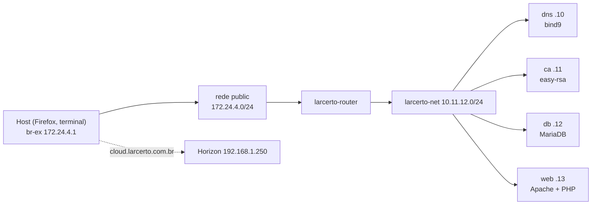

# Nuvem LarCerto — do lab ligado até `https://larcerto.com.br`

Passo a passo do Trabalho 1 sobre o Kolla AIO deste repo. Plano completo:
[`../../.specs/trabalho-1/plano.md`](../../.specs/trabalho-1/plano.md).

## Topologia (REQ09, "completa")



Cada VM tem um floating IP da `public` (pool `.100–.199`). O `db` só aceita a 3306 vindo da
`larcerto-net`.

## Diferenças em relação às aulas

| Aula | Aqui | Por quê |
|------|------|---------|
| DevStack em Multipass (M06) | Kolla AIO no host | lab do repo |
| br-ex com IP e NAT refeitos à mão após reboot (M06/M07) | `./project/lab.sh ext-net` (chamado pelo `start`) | mesma ideia, automatizada e reversível (`--down`) |
| boot de volume (M07/M08) | boot da imagem, disco de 10 GB do flavor | Kolla deployado sem Cinder |
| DNS e CA em VMs Multipass (M05) | VMs `dns` e `ca` dentro do OpenStack | topologia "completa", sem mexer mais no host |
| senha no `providers.tf` (M09) | `clouds.yaml` do `devops1` fora do git | segredos fora do repo |
| CSR gerado na web e assinado na CA (M05) | `build-server-full` na VM `ca` | menos passos; a chave chega à web pelo Ansible |

## Pré-requisitos (uma vez, no host)

| O quê | Comando | Observação |
|-------|---------|------------|
| Cliente OpenStack no venv | `~/venvs/kolla/bin/pip install python-openstackclient` | só o venv, não o sistema |
| Terraform | binário em `~/.local/bin/terraform` (releases.hashicorp.com) | sem apt |
| Chave SSH | `ssh-keygen -t ed25519` (se não existir `~/.ssh/id_ed25519`) | |
| Senha do banco | `cp project/ansible/group_vars/all/secrets.yml.example project/ansible/group_vars/all/secrets.yml` e editar | fora do git |
| `dig` | já vem no `bind9-dnsutils`/`dnsutils` | só para conferir |

## Subir tudo

```bash
./project/lab.sh start                 # Kolla + ext-net (br-ex 172.24.4.1 + NAT) + fix-wired
./project/cloud/bootstrap.sh           # admin: public, ds1G, ubuntu-22.04, projeto larcerto, devops1
export OS_CLIENT_CONFIG_FILE=$PWD/project/cloud/secrets/clouds.yaml OS_CLOUD=larcerto-devops1
cd project/terraform && terraform init && terraform apply     # 4 VMs + inventory/hosts.ini
cd ../ansible && ~/venvs/kolla/bin/ansible-playbook site.yml  # dns, ca, db, web
cd ../.. && ./project/lab.sh dns-host  # host resolve *.larcerto.com.br pela VM dns
```

Importar `project/ansible/files/pki/ca.crt` no Firefox (Configurações → Certificados →
Autoridades → Importar → "confiar para identificar sites"). A CA é reaproveitada a cada
recriação, então isso é feito uma vez só.

## Conferir

```bash
bash project/tests/cloud-checks.sh     # dns_www, dns_cloud, dns_db_from_web, http_redirect, https_ok
```

## Recriar (demonstração / REQ25)

```bash
cd project/terraform && terraform destroy && terraform apply
cd ../ansible && ~/venvs/kolla/bin/ansible-playbook site.yml
```

## Desfazer no host

```bash
./project/lab.sh dns-host --down       # resolvedor do host volta ao normal
./project/lab.sh ext-net --down        # tira o IP da br-ex e as regras de NAT/FORWARD
```

## App

O CRUD de imóveis (S5) está **pendente**: ver [`../app/README.md`](../app/README.md). Até lá,
`https://larcerto.com.br` mostra uma página provisória com o logo e o status da conexão com o banco.
